<!-- ═══════════════════════════ HEADER ═══════════════════════════ -->
<p align="center">
  
</p>

<p align="center">
  <a href="https://www.linkedin.com/in/luis-gonzalez-olaya">
    
  </a>
  <a href="https://open.spotify.com/user/vmt7lpqdatuelp2chw7ur2p2l">
    
  </a>
  
</p>

<br />

## `$ whoami`

```js
const minato = {
  rol:          "Full Stack Developer",
  base:         "Ecuador 🇪🇨",
  estudiando:   "Tecnologías de la Información @ UTMACH",
  construyendo: "Sistema de gestión bananera con IA",
  enfoque:      ["Clean Architecture", "Seguridad", "UX coherente"],
  inspiracion:  "anime × diseño tech minimalista",
};
```

Construyo aplicaciones web y móviles de punta a punta: APIs bien estructuradas en el backend e interfaces claras en el frontend.
Me importa que el código **funcione hoy y se pueda mantener mañana**: arquitectura limpia, seguridad desde el diseño y una experiencia visual coherente.

<br />

## 🛠️ Stack

<table align="center">
  <tr>
    <td align="right"><sub><b>FRONTEND</b></sub></td>
    <td>
      
      
    </td>
  </tr>
  <tr>
    <td align="right"><sub><b>BACKEND</b></sub></td>
    <td></td>
  </tr>
  <tr>
    <td align="right"><sub><b>DATOS & IA</b></sub></td>
    <td></td>
  </tr>
  <tr>
    <td align="right"><sub><b>TOOLS</b></sub></td>
    <td></td>
  </tr>
</table>

<br />

## 🚧 Construyendo ahora

> **🍌 Sistema de gestión bananera** — plataforma web y móvil para la gestión de fincas bananeras, con módulo de IA para análisis predictivo.
>
> `Ionic + Angular` · `Node + Express` · `PostgreSQL + PostGIS (Supabase)` · `Python + FastAPI + scikit-learn`

<br />

## 🎧 Sonando ahora

<p align="center">
  <!-- Reemplaza TU-PROYECTO por el nombre de tu deploy en Vercel (ver instrucciones) -->
  <a href="https://github.com/tthn0/Spotify-Readme">
    
  </a>
</p>

<div align="center">

| 💻 Programming Music | 💜 K-Pop Vibes | 🌸 P-Pop Mood |
|:---:|:---:|:---:|
| [▶ Escuchar](https://open.spotify.com/playlist/1FWq5Cu05LmtSHgFEXRnZO) | [▶ Escuchar](https://open.spotify.com/playlist/2DFExFNWYOwQMZy6wUeCxX) | [▶ Escuchar](https://open.spotify.com/playlist/58bZKfJFpUl2CwWET1QJ3X) |

</div>

<br />

## 🐍 Actividad

<p align="center">
  <picture>
    <source media="(prefers-color-scheme: dark)" srcset="https://raw.githubusercontent.com/LuisGonzalezMG/LuisGonzalezMG/output/github-snake-dark.svg" />
    <source media="(prefers-color-scheme: light)" srcset="https://raw.githubusercontent.com/LuisGonzalezMG/LuisGonzalezMG/output/github-snake.svg" />
    
  </picture>
</p>

<!-- ═══════════════════════════ FOOTER ═══════════════════════════ -->
<p align="center">
  <sub>código limpio · café · lo-fi &nbsp;—&nbsp; <code>minato@dev:~$ exit</code></sub>
</p>
